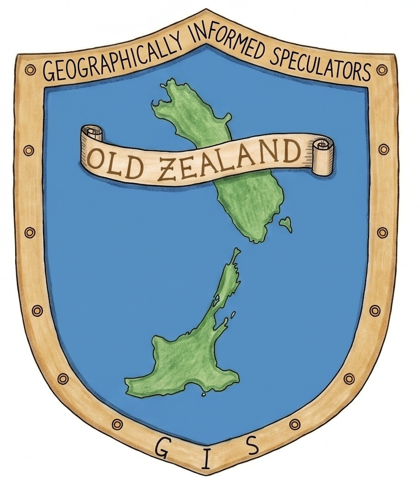
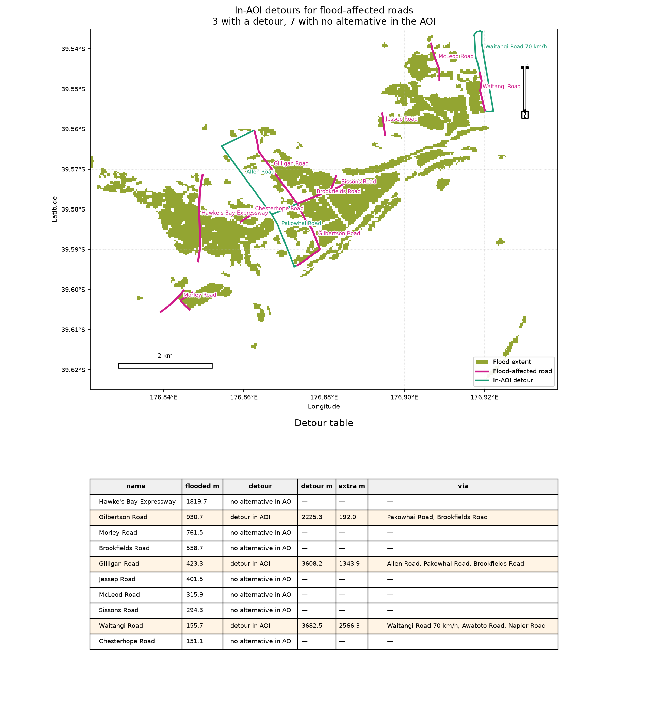
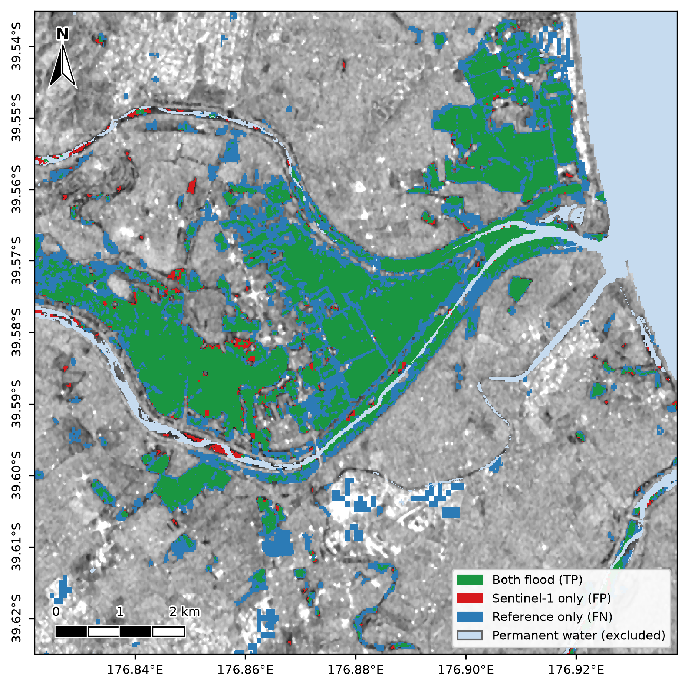
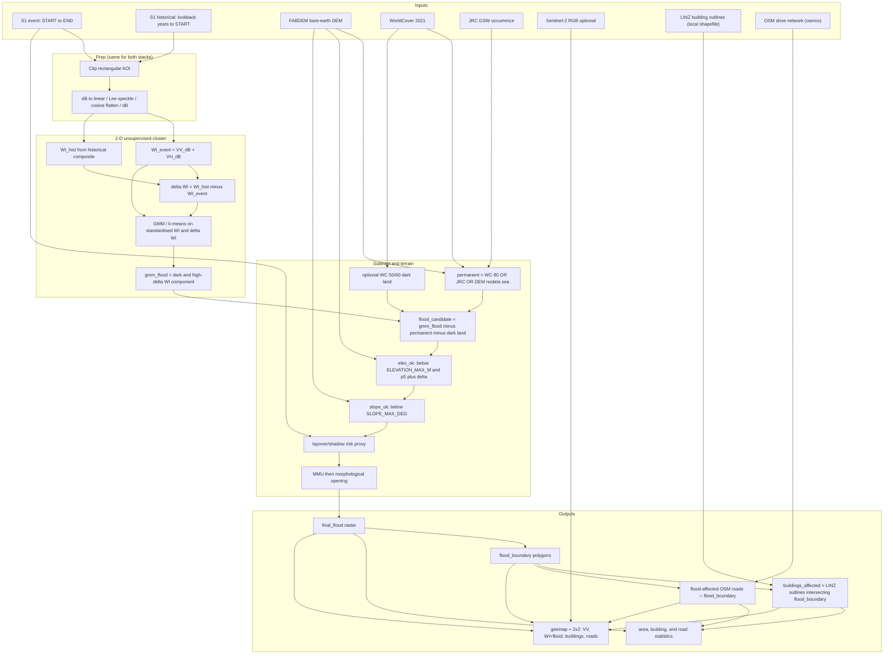

#  Geographically Informed Speculators (GIS)

GEOG761 group project: mapping **flood and inundation extent** after a disaster, as the entry point for choosing a sea-logistics / HA-DR site.

The Sentinel-1 notebook (`01_sentinel1_layer.ipynb`) is the method of record. The map UI uses calendar dates and a Leaflet AOI, without editing `layer_config.py` for coordinates or dates. Flood is an **unsupervised 2-D GMM** cluster on event `WI` and historical `ΔWI` (dark **and** newly darker than a multi-year mean). That replaces the earlier 1-D **Otsu** cut on WI plus a fixed `ΔWI` dB threshold.

---


## The problem

Selecting a suitable site for logistics supply from sea, immediately following a disaster event requiring HA/DR support.

**Scope:** focus on flood and inundation extent as the entry point.

- Ports may fail
- Beach landing becomes the fallback
- Roads destroyed
- Communities and islands cut off
- Survey data outdated
- Pre-event knowledge no longer reliable

---


## Observation and method

**Mapping flood extent with Sentinel-1** (`notebooks/01_sentinel1_layer.ipynb`). Notebook AOI/dates still live in `notebooks/layer_config.py`. The UI does not use those date/coordinate fields; it sends them over HTTP. Terrain / MMU thresholds in `processing/defaults.py` match the notebook. Flood pixels come from **unsupervised clustering** (GMM on the map; k-means as a comparison), not Otsu.

**Inputs**


| Input                            | Collection / product                                                                                                                              | Role                                                                                                                        |
| -------------------------------- | ------------------------------------------------------------------------------------------------------------------------------------------------- | --------------------------------------------------------------------------------------------------------------------------- |
| Sentinel-1 event stack           | `COPERNICUS/S1_GRD` IW, 10 m, `START_DATE`–`END_DATE`                                                                                             | Event composite; `WI_event = VV_dB + VH_dB`                                                                                 |
| Sentinel-1 historical stack      | Same collection, `HIST_LOOKBACK_YEARS` ending at `START_DATE`                                                                                     | Mean WI before the event (`WI_hist`). Event window is excluded                                                              |
| FABDEM (bare-earth DEM)          | `projects/sat-io/open-datasets/FABDEM`                                                                                                            | Elevation, slope, sea (nodata). GLO-30 with buildings/trees removed                                                         |
| ESA WorldCover 2021              | `ESA/WorldCover/v200/2021`                                                                                                                        | Permanent water (class 80); optional dark-land classes 50/60 (runways)                                                      |
| JRC Global Surface Water         | `JRC/GSW1_4/GlobalSurfaceWater` `occurrence`                                                                                                      | Permanent / frequent water                                                                                                  |
| Sentinel-2 RGB (optional figure) | `COPERNICUS/S2_SR_HARMONIZED`                                                                                                                     | Context RGB, not the flood classifier                                                                                       |
| LINZ NZ Building Outlines        | [LINZ layer 101290](https://data.linz.govt.nz/layer/101290-nz-building-outlines/), local shapefile at `data/nz-building/nz-building-outlines.shp` | Roof outlines (≥ 10 m²) from aerial imagery; counts buildings that touch the flood. Not on GEE; read locally with GeoPandas |
| OpenStreetMap drive network      | Overpass via `osmnx` (`network_type="drive"`)                                                                                                     | Named roads, lanes, bridge/tunnel tags, and a connected graph for flood-affected / detour checks (notebook 5e and UI)       |


**How a pixel becomes flood**

1. **Prep** — clip to a rectangular AOI; convert dB → linear power; Lee speckle filter; simplified cosine terrain flatten; back to dB. The **same** recipe is applied to the event stack and to the historical stack.
2. **Features** — dual-pol index `WI = VV_dB + VH_dB`. Historical change `ΔWI = WI_hist − WI_event` (positive = newly darker than the lookback mean). Always-dark water and pavement stay near `ΔWI ≈ 0`.
3. **Unsupervised 2-D GMM / k-means** — this step **replaces Otsu**. Standardise (`WI`, `ΔWI`); sample AOI pixels with permanent water excluded so the sea does not dominate the fit; fit a **4-component GMM** (`sklearn.mixture.GaussianMixture`, full covariance) and **k-means** on the same samples. Flood is the component with the **lowest WI among those with positive mean ΔWI**. Permanent dark water sits at low WI and `ΔWI ≈ 0`; dry land is brighter. GMM is the map; k-means is comparison only. There is no WI histogram threshold and no `WI_CHANGE_MIN_DB` cut.
4. **Flood candidate** — GMM flood cluster, then drop WorldCover 80, JRC occurrence ≥ threshold, DEM nodata (open sea), and optional WorldCover 50/60. WorldCover / JRC / DEM are **post-masks**, not GMM features.
5. **Terrain** — drop high ground (`ELEVATION_MAX_M` and optional height above AOI FABDEM p5) and slopes steeper than `SLOPE_MAX_DEG`; layover/shadow *risk proxy* from slope vs incidence angle. Elevation is **FABDEM** (bare earth), not raw Copernicus GLO-30 (DSM with buildings/trees).
6. **Clean** — minimum mapping unit, then a small morphological opening.
7. **Vectorise** — `final_flood` → `flood_boundary` polygons (`reduceToVectors`, 40 m, eight-connected).
8. **Building exposure** — LINZ outlines ∩ `flood_boundary` (see below).
9. **Road exposure** — OSM drive edges ∩ `flood_boundary`; flood-affected names, inundated carriageway area, in-AOI detours (notebook 5e and `processing/roads.py`).
10. **Output** — flood raster, boundary polygons, area / building / road stats, 2×2 figure.


### Counting affected buildings (LINZ ∩ flood)

Code: `processing/buildings.py`, used by notebook section 5d and the UI pipeline.

1. **Download.** Export *NZ Building Outlines* from the LINZ Data Service as a shapefile (WGS 84 or NZTM2000 both work) and unzip it into `data/nz-building/`. The path is `BUILDING_OUTLINES_PATH` in `notebooks/layer_config.py` and `processing/defaults.py`. Shapefile sidecars are gitignored.
2. **Clip to the AOI.** `gpd.read_file(path, bbox=AOI_BOUNDS)` reads only outlines inside the AOI rectangle (the national file is large), reprojected to WGS 84. This is `buildings_in_aoi`.
3. **Bring the flood to the client.** `flood_boundary` (Earth Engine `FeatureCollection`) is pulled with `getInfo()` and turned into a GeoDataFrame in WGS 84.
4. **Intersect.** `gpd.sjoin(buildings, flood, predicate="intersects")`. A building counts once if **any part** of its roof outline touches flood water; duplicates from multiple flood polygons are dropped on `building_i`. This is `buildings_affected`.
5. **Footprint area.** The affected outlines are overlaid with the flood polygons in **NZTM2000** (`EPSG:2193`) so the wetted roof area is in square metres (`buildings_affected_footprint_km2`). The count itself does not depend on the CRS.


| Stat key                           | Meaning                                       |
| ---------------------------------- | --------------------------------------------- |
| `buildings_in_aoi`                 | LINZ outlines inside the AOI rectangle        |
| `buildings_affected`               | Outlines intersecting `flood_boundary`        |
| `buildings_affected_pct`           | `buildings_affected / buildings_in_aoi × 100` |
| `buildings_affected_footprint_km2` | Area of outline ∩ flood, NZTM2000             |


The figure's bottom-left panel draws flood in yellow, AOI outlines in grey and affected outlines in red. The notebook map adds only the affected outlines as a layer (uploading every AOI outline to Earth Engine is slow).

**Read these numbers as exposure, not damage.** A building is counted even if only its edge touches a 10–40 m flood pixel, so the count leans high near flood boundaries. Outlines include garages and sheds and are not households. They also reflect the imagery date (for Hawke's Bay, 2023–2024), so buildings demolished after Gabrielle may still appear.

### Detecting flood-affected roads (OSM ∩ flood)

Code: `processing/roads.py`, used by notebook section 5e and the UI pipeline. Thresholds live in `processing/defaults.py` (`ROAD_CLOSED_MIN_LENGTH_M`, `ROAD_CLOSED_MIN_FRAC`, lane width, detour-name cap).

OSM is used instead of LINZ Topo50 because drive edges form a **connected graph**, with `name`, `highway`, `lanes`, `bridge`, and `tunnel`. That lets the notebook (1) skip elevated crossings that only look flooded because the centreline crosses the river, and (2) search an in-AOI detour after flooded edges are removed.

1. **Download.** `osmnx.graph_from_bbox` on `AOI_BOUNDS`, `network_type="drive"` (Overpass; first run needs network, later runs may use the OSMNx cache).
2. **Ground roads.** Drop edges tagged `bridge` or `tunnel`. Length and area are computed in **NZTM2000** (`EPSG:2193`).
3. **Intersect.** Flooded **length** = centreline ∩ `flood_boundary`. Flooded **area** = carriageway buffer ∩ flood. Buffer half-width = `lanes × 3.5 m / 2`, minimum 3.5 m.
4. **Flood-affected.** An edge is flood-affected if flooded length ≥ **50 m** **or** flooded length / edge length ≥ **30%**. Short slivers at the SAR/vector edge are ignored. Names are aggregated from OSM `name` (unnamed ways stay `(unnamed)`).
5. **Detour.** Copy the graph, remove every flood-affected edge, then `networkx.shortest_path` between the endpoints of the longest flooded edge per name. If a path exists, extra metres versus the original edge are stored; if not, the AOI graph has no alternative (the road may still be reachable from outside the box).


| Stat key                                        | Meaning                                                                                             |
| ----------------------------------------------- | --------------------------------------------------------------------------------------------------- |
| `roads_in_aoi_km`                               | OSM drive centreline length in the AOI                                                              |
| `roads_flooded_km`                              | Centreline length intersecting `flood_boundary`                                                     |
| `roads_flooded_area_km2`                        | Carriageway buffer ∩ flood, NZTM2000                                                                |
| `roads_flood_affected_edges`                    | Flood-affected edges meeting the 50 m / 30% rule                                                    |
| `roads_flood_affected_names`                    | Count of unique OSM names among flood-affected edges                                                |
| `roads_flood_affected_name_list`                | Those names, longest flooded first                                                                  |
| `roads_not_flood_affected_name_list`            | Remaining (not flood-affected) ground-road names, longest first                                     |
| `roads_with_aoi_detour` / `roads_no_aoi_detour` | Names with / without an in-AOI alternative                                                          |
| `roads_detours`                                 | Per-name rows: flooded length, detour status, `detour_route` (named streets in order), extra metres |


The figure's bottom-right panel draws flood in yellow, **not flood-affected** roads in teal, and **flood-affected** roads in magenta. The notebook map adds the flood-affected edges as a magenta layer. Notebook section 5f (after the 2×2) maps those edges against in-AOI detours.

**Read these as a geometric/network proxy, not an official closure list.** SAR flood pixels are 10–40 m; a centreline has no width. Bridges can still be misclassified if OSM tags are missing. In-AOI “no detour” does not mean the rest of Hawke’s Bay is unreachable. Official NZTA / council closures are a different dataset.

Defaults: `HIST_LOOKBACK_YEARS = 1` in `notebooks/layer_config.py` (UI `processing/defaults.py` matches). `WI_CHANGE_MIN_DB` and `WATER_INDEX_MAX_DB` are leftover from the old 1-D Otsu path; `01_` **and** `04_` **do not use them**.

SAR is used because it works through cloud (storms/cyclones). Sentinel-2 is a secondary optical check, not the primary flood classifier.

**Honesty:** Lecture 6 maps land vs water with **Random Forest on VV/VH**. This notebook uses **unsupervised 2-D GMM / k-means** on (`WI`, `ΔWI`) because flood polygons are not training labels. WorldCover / JRC / FABDEM are applied **after** clustering. The historical layer is a **lookback composite**, not a matched pre-event / post-event pair (different orbits and seasons are averaged together).

### Example program output figure

The generated comparison figure is a **2 × 2** grid: Sentinel-1 VV (top left), water index with `final_flood` in yellow (top right), LINZ buildings ∩ flood (bottom left), OSM flood-affected vs not flood-affected roads (bottom right).


### Example in-AOI detours for flood-affected roads

Notebook section 5f plots the flood-affected OSM edges (magenta) against the remaining in-AOI shortest path (green) and the same detour table printed in 5e. This example is Cyclone Gabrielle, **±5 km at** `[-39.58, 176.88]`: two named roads have an in-AOI detour; eight have no alternative inside the box.



### Example Sentinel-2 U-Net output

The Sentinel-2 tab (`notebooks/02_sentinel2_layer.ipynb`, `processing/s2_pipeline.py`) produces a **1 × 3** figure from the first L1C scene on or after the peak date: event RGB with scale bar and north arrow (left), pretrained U-Net++ water (middle), and final flood = U-Net water minus permanent water on low / flat ground (right). This example is Cyclone Gabrielle, 14 Feb 2023 (~61% cloud). Parts of the cloud deck are labelled flood, so read optical results alongside the Sentinel-1 map.

**Pretrained model used**

- **Checkpoint:** `sm_unet_s2.pt` with `sm_unet_s2.json`, downloaded from Hugging Face `[isp-uv-es/udl4fl_models](https://huggingface.co/isp-uv-es/udl4fl_models)`.
- **Architecture:** `segmentation_models_pytorch.UnetPlusPlus` with a **MobileNetV2 encoder**, six input channels, and two output classes: `land` and `water`. Although the checkpoint is named `sm_unet_s2` and its JSON says `unet`, the saved decoder keys match **U-Net++**.
- **Training domain:** the published model was trained on **WorldFloods + S1S2Water**. It is loaded as-is and is **not retrained or fine-tuned on Aotearoa**. This is different from the course Lab 5 exercise, which builds a local six-band U-Net with ImageNet encoder weights.
- **Input:** one `COPERNICUS/S2_HARMONIZED` **Level-1C TOA** scene, using native DN values in band order `B2, B3, B4, B8, B11, B12` (blue, green, red, NIR, SWIR1, SWIR2). The model-specific mean and standard deviation come from `sm_unet_s2.json`. Surface-reflectance data are not substituted because the checkpoint was trained on L1C.
- **Inference:** export at 10 m, run overlapping 256 × 256 tiles with reflection padding, apply softmax, and retain class-1 water where `P(water) ≥ 0.6`. Invalid/nodata pixels are excluded.
- **Flood product:** the network predicts **event water, not flood**. Final flood is U-Net water minus WorldCover/JRC permanent water and DEM-nodata sea, restricted to the configured low/flat FABDEM mask, then cleaned with the minimum mapping unit.
- **Licence:** the model is CC BY-NC, so this use is non-commercial/coursework only.

There is no pre-event optical change test in this branch. Clouds, cloud shadow, sunglint, turbid water, and transfer from the global training data to Hawke's Bay can therefore cause error. The model output should be treated as a secondary optical check on the Sentinel-1 result, not an independent all-weather flood map.


### Evaluation against Dragonfly flood extent

`notebooks/04_validation.ipynb` rebuilds the same 2-D GMM `final_flood` as `01_sentinel1_layer.ipynb`, then scores it against the Dragonfly Data Science Hawke’s Bay flood polygons for **14 Feb 2023** ([data release](https://www.dragonfly.co.nz/news/2023-02-17-cyclone-gabrielle)). Urban and non-urban GeoPackages are merged, clipped to the AOI, and painted to a raster. **Permanent water is dropped on both maps** so the scores cover new inundation only. Re-run the notebook to refresh `outputs/validation/agreement.png` after GMM changes.


| Code       | Meaning                         |
| ---------- | ------------------------------- |
| TP (green) | Both maps flood                 |
| FP (red)   | Sentinel-1 flood, Dragonfly dry |
| FN (blue)  | Dragonfly flood, Sentinel-1 dry |
| TN         | Both dry (not drawn)            |


Pixel areas are summed at 20 m (`AREA_SCALE`). From those areas:

`precision = TP / (TP + FP)` · `recall = TP / (TP + FN)` · `F1 = 2PR / (P + R)` · `IoU = TP / (TP + FP + FN)`

This example is Cyclone Gabrielle, **±5 km at** `[-39.58, 176.88]`, event window 12–17 Feb 2023: **IoU = 0.74**, **F1 = 0.85**.



**Read this as method agreement, not ground-truth accuracy.** The Dragonfly 14 Feb layer is itself a Sentinel-1 product and is likely from the same 14 Feb ~07:07 UTC pass, so the scores are an **upper bound**. Reference products are model outputs, not field surveys. The separate 19/21 Feb Dragonfly silt/slip layer is discussed below as an experimental sediment-mapping label; it is not part of the flood accuracy score. Urban recall is near zero because flooded streets stay bright in SAR (double bounce), so a “darker than history” rule misses them.

---


## Discussion


### Experimental post-flood silt mapping

`notebooks/05_silt_layer.ipynb` tests whether Sentinel-1 can identify sediment deposits after Cyclone Gabrielle, including places where standing floodwater had receded. This is an exploratory extension and is **not included in the validated flood product or UI** because its hold-out performance is not yet adequate.

The experiment is motivated by Ma et al. (2024), *[Using SAR imagery to extract flash flood sediment deposition area in the northern Loess Plateau](https://doi.org/10.1016/j.jhydrol.2024.132045)*. Their PODPC method reported strong threshold separation from powered polarisation combinations. The notebook adapts the reported best combinations to a supervised Random Forest:

- post-event `VV³`, `(VV + VH)⁶`, and `(VV × VH)³`;
- same-orbit change `ΔVV` and `ΔVH` (pre minus post);
- Sentinel-1 incidence angle.

The selected post-event scene is Sentinel-1 IW GRD from **20 February 2023**, descending relative orbit **175**. Its baseline is the same-pass, same-orbit scene from **8 February 2023**. Both VV and VH receive the Lecture 6-style 50 m focal-mean speckle operation.

Dragonfly `silt` and `slip` polygons from 19/21 February form class 1. Class 0 is all other eligible land and can include Dragonfly `flood`. WorldCover/JRC permanent water is excluded from both training and testing, rather than taught as “not silt.” Training samples come from the outer buffer with the map AOI removed; testing uses only the AOI. Samples are drawn at 20 m, and silt is oversampled during training to address low recall. These labels are another remote-sensing model, not field observations, and combining `silt` with `slip` broadens the meaning of the positive class.

The latest balanced AOI hold-out contained 50 not-silt and 50 silt/slip samples. At `P(silt) > 0.50`, the result was:


| Reference class | Predicted not-silt | Predicted silt |
| --------------- | ------------------ | -------------- |
| Not-silt        | 23                 | 27             |
| Silt/slip       | 26                 | 24             |


Overall accuracy was **0.47**, silt recall **0.48**, and Cohen's kappa **−0.06**. Lowering the probability threshold increased recall but did not create useful separation: at 0.35, recall reached **0.90**, while **45 of 50** not-silt samples became false positives. This trade-off indicates substantial overlap between the SAR response of sediment, wet ground, floodwater, and ordinary land; changing the threshold alone cannot fix the model.


The method also differs materially from the cited study: PODPC was designed to improve histogram/Otsu thresholding in the Loess Plateau, whereas this notebook uses those transforms as RF predictors in vegetated Hawke's Bay. A cubic transform of VV is monotonic and therefore adds no new ordering information to a tree compared with VV itself. The Dragonfly label dates, SAR acquisition time, 50 m smoothing, mixed `silt`/`slip` target, and transfer between different landscapes further limit interpretation.

For these reasons, the silt RF is retained as a discussion experiment only. Useful next steps would require independent field labels, separate silt and slip classes, texture/land-cover predictors, more events, spatially blocked validation, and comparison of the paper's original threshold workflow against untransformed VV/VH baselines.

---


## Architecture

The notebook (`01_sentinel1_layer.ipynb`) is the lab-style reference. Flood is the GMM cluster on (`WI`, `ΔWI`); k-means is fitted on the same samples for comparison only.

Two Sentinel-1 stacks share one AOI and the same Lee / terrain-flatten steps:


| Stack      | Date filter                                       | Role                                                   |
| ---------- | ------------------------------------------------- | ------------------------------------------------------ |
| Event      | `START_DATE` → `END_DATE`                         | `WI_event` (one axis of the 2-D clusterer)             |
| Historical | `START_DATE − HIST_LOOKBACK_YEARS` → `START_DATE` | `WI_hist`; `ΔWI = WI_hist − WI_event` (the other axis) |


Flood is the GMM component that is dark **and** newly darker than history, then WorldCover / JRC / DEM filters. Sentinel-2 is optional optical context, not the flood classifier. The comparison figure is a 2×2 of event Sentinel-1 VV, water index with `final_flood`, LINZ buildings, and OSM flood-affected roads.




**Logical proposition:** flood = 2-D GMM cluster on (`WI_event`, `ΔWI`) that is dark and newly darker than the historical mean, minus permanent water, on low / flat ground.

**Event trigger (pitch context):** MetService / news. Implementation will start from a user-selected AOI and date range rather than a live alert feed.

---


## Map UI

A local FastAPI page (`ui/`) plus Leaflet. Dates, AOI, max slope, and max elevation are chosen in the browser. Historical lookback, FABDEM terrain caps, and MMU live in `processing/defaults.py`. The flood rule to match is the notebook **GMM**, not Otsu.

### Design

Dark layout, gold accent. Team name **Geographically Informed Speculators** in the header. Optional logo at `ui/static/logo.png` or `assets/logo/logo.png` (missing image is hidden).

```text
┌─────────────────────────────────────────────────────────────┐
│  [logo]  Geographically Informed Speculators                │
│          Flood / inundation extent · GEOG761                │
│  [ Sentinel-1 SAR ]  [ Sentinel-2 U-Net ]                   │
├──────────────────┬──────────────────────────────────────────┤
│ Event window     │                                          │
│  start / end /   │           Leaflet map (this tab only)    │
│  peak (calendar) │   click = centred rectangle              │
│                  │   draw tool = custom box                 │
│ Area of interest │                                          │
│  half-width km   │                                          │
│  AOI text        │                                          │
│ Terrain filters  │                                          │
│  max slope (deg) │                                          │
│  max elev (m)    │                                          │
│  [Run flood…]    │                                          │
│  progress bar    │                                          │
│  step + elapsed  │                                          │
├──────────────────┴──────────────────────────────────────────┤
│ Figure — 2×2: VV, WI+flood, LINZ buildings, OSM roads       │
│ Key Flood Statistics — table (area, buildings, roads)       │
└─────────────────────────────────────────────────────────────┘
```

Tabs do not share form fields, Leaflet maps, or run state. Sentinel-1 uses `POST /api/run`. Sentinel-2 U-Net uses `POST /api/run-s2` (`processing/s2_pipeline.py`, same flow as `notebooks/02_sentinel2_layer.ipynb`). Poll both with `GET /api/job/{job_id}`.


| Region     | What it does                                                                                                                                                                                                                                                                                                       |
| ---------- | ------------------------------------------------------------------------------------------------------------------------------------------------------------------------------------------------------------------------------------------------------------------------------------------------------------------ |
| Header     | Team name, optional logo, and tabs (**Sentinel-1 SAR** vs **Sentinel-2 U-Net**)                                                                                                                                                                                                                                    |
| Left panel | Native date pickers (start, end, optional peak; default peak is the window midpoint). Half-width (km) for click-to-centre mode. **Max slope (°)** and **max elevation (m)** (defaults `SLOPE_MAX_DEG=10`, `ELEVATION_MAX_M=25`). Run button. Live **progress** under the button: bar, `Step n/10: …`, elapsed time |
| Map        | OpenStreetMap. **Click** places a gold rectangle of ± half-width km. Leaflet.draw **rectangle** tool for a custom box. Selected bounds are shown as text                                                                                                                                                           |
| Results    | Same 2×2 figure as notebook section 5c (LINZ buildings ∩ flood; OSM flood-affected vs not flood-affected roads), then a **Key Flood Statistics** table: flood area, share of AOI, buildings, flooded road length/area, flood-affected name count and names                                                         |


Defaults match Cyclone Gabrielle at Hawke’s Bay Airport: 2023-02-01 → 2023-02-25, peak 2023-02-15, 5 km half-width, map centred at about `[-39.471, 176.869]`. Terrain defaults are **10°** max slope and **25 m** max elevation (`GET /api/defaults` loads these from `processing/defaults.py`).

### UI parameters

These controls are sent with `POST /api/run`. They replace the notebook’s `START_DATE` / `END_DATE` / `MAP_CENTER` / `AOI_RADIUS_KM` / `SLOPE_MAX_DEG` / `ELEVATION_MAX_M`. Lookback, FABDEM relative cap, and MMU stay in `processing/defaults.py`. Flood class membership comes from the **2-D GMM**, not from `WATER_INDEX_MAX_DB` or `WI_CHANGE_MIN_DB`.


| Control           | JSON field                       | Default                               | Role                                                                                                                              |
| ----------------- | -------------------------------- | ------------------------------------- | --------------------------------------------------------------------------------------------------------------------------------- |
| Start             | `start_date`                     | 2023-02-01                            | Inclusive start of the Sentinel-1 event window. Also the **end** of the historical lookback                                       |
| End               | `end_date`                       | 2023-02-25                            | Exclusive-style end of that window (must be after start). Event SAR scenes in this range are composited                           |
| Peak              | `peak_date`                      | 2023-02-15                            | Date used to pick the closest Sentinel-1 scene for metadata. If empty, the midpoint of start–end is used                          |
| Map click         | `center_lat`, `center_lon`       | none (click required unless you draw) | Centre of an axis-aligned rectangle. Builds the AOI together with half-width                                                      |
| Half-width (km)   | `half_km`                        | 5                                     | Distance north/south/east/west from the click. Only used in click-to-centre mode (same idea as notebook `AOI_RADIUS_KM`)          |
| Draw rectangle    | `west`, `south`, `east`, `north` | none                                  | Custom AOI box. If you draw, these bounds are used and half-width is ignored                                                      |
| Max slope (deg)   | `slope_max_deg`                  | 10                                    | Drop flood candidates on slopes **≥** this (steep ground is flood-implausible and layover/shadow-prone)                           |
| Max elevation (m) | `elevation_max_m`                | 25                                    | Drop flood candidates at or above this FABDEM height. A second relative cap (`ELEVATION_ABOVE_P5_M`) still applies in the backend |


**Progress steps (shown under the button):** (1) initialise Earth Engine, (2) search Sentinel-1, (3) Sentinel-2 RGB, (4) DEM / WorldCover / JRC, (5) Lee + terrain flatten, (6) water index + historical `ΔWI` + **2-D GMM flood cluster**, (7) elevation / slope / layover masks, (8) vectorise flood polygons, (9) area statistics, LINZ buildings, and OSM flood-affected roads, (10) render figure. Earth Engine is lazy, so the bar can sit on steps 6, 7 and 9 for a while (step 9 also waits on Overpass). Only **one** run at a time; a second job waits.

**Optional Gemini analysis:** set any of `REPORT_ANALYSIS`, `REPORT_IMPLICATIONS`, `REPORT_UNCERTAINTIES`, `REPORT_CONCLUSION` to `True` in `processing/defaults.py` to add those HTML sections under the statistics table (needs `GEMINI_KEY` in `.env`). All `False` skips the Gemini call.

### How to run

**Prerequisites**

- Python ≥ 3.13 and [uv](https://docs.astral.sh/uv/)
- A Google Earth Engine Cloud project (`EE_PROJECT`) and a **service-account JSON** at `GOOGLE_APPLICATION_CREDENTIALS` (see `.env.example`). Interactive `earthengine authenticate` is only a fallback if that env var is unset.

```bash
# Copy .env.example to .env and set EE_PROJECT + GOOGLE_APPLICATION_CREDENTIALS
# plus GEMINI_KEY if you want the HTML report.
```

**Start the server** (from the repo root):

```bash
# Values also come from repo-root .env (EE_PROJECT, GOOGLE_APPLICATION_CREDENTIALS).
# Includes the s2-unet group (geedim, torch, …) via [tool.uv] default-groups.
uv sync
uv run uvicorn ui.app:app --reload --host 127.0.0.1 --port 8000
```

Open **[http://127.0.0.1:8000](http://127.0.0.1:8000)**

1. Set start / end / peak on the calendars (or keep the Gabrielle defaults).
2. Click the map, or draw a rectangle.
3. Click **Run flood mapping**.
4. Watch the progress box until the figure and stats appear below.

Jobs usually take **several minutes**. `--reload` picks up Python changes; refresh the browser for HTML/CSS/JS. API: `POST /api/run` then poll `GET /api/job/{job_id}` (status, progress, result).

---


---
 
 
 
## Team contributions
 
| Members involved | Project contribution | Where it lives in the repo |
| ----------------- | -------------------- | -------------------------- |
| (edit name here) | Problem framing and scope (HA/DR site selection after a disaster), method and data selection, Cyclone Gabrielle case study | README: [The problem](#the-problem), [Observation and method](#observation-and-method), [Expected product and risks](#expected-product-and-risks) |
| (edit name here) | Primary Sentinel-1 flood pipeline: unsupervised 2-D GMM on `WI` and `ΔWI`, WorldCover / JRC / FABDEM post-masks, flood vectorisation, area statistics; LINZ building and OSM road exposure | `notebooks/01_sentinel1_layer.ipynb`, `processing/pipeline.py`, `processing/buildings.py`, `processing/roads.py` |
| (edit name here) | Methods research and assessment; map UI (Sentinel-1 and Sentinel-2 tabs); Sentinel-2 flood layer using a pretrained U-Net (inference only) | `ui/`, `notebooks/02_sentinel2_layer.ipynb`, `processing/s2_pipeline.py` |
| (edit name here) | Validation of the Sentinel-1 flood map against the Dragonfly 14 Feb flood extent (confusion matrix, precision, recall, F1, IoU, urban vs non-urban recall); GMM vs k-means comparison | `notebooks/04_validation.ipynb`, `outputs/validation/` |
| (edit name here) | Experimental post-flood silt mapping (Random Forest, Dragonfly labels; not part of the validated product or UI); limitations analysis and further work | `notebooks/05_silt_layer.ipynb`, `outputs/silt_layer/`, README: [Discussion](#discussion) |
 
---


## Expected product and risks

**Product**

- A map of flood and inundation extent for a chosen AOI and **event** date range, from an unsupervised 2-D GMM on Sentinel-1 (`WI`, `ΔWI`) versus a multi-year historical mean (optional Sentinel-2 RGB for context).
- A notebook or GitHub repository containing the code.
- Run on past flood events to show the method works.
- A partner can adapt it to their own SAR data.

**Risks:** revisit rate, training data, compute limits.

---


## Course mapping


| Pipeline step                                                    | Course source                                 |
| ---------------------------------------------------------------- | --------------------------------------------- |
| GEE + geemap ingest and map display                              | Lab 1                                         |
| Sentinel-2 pixel ML, spectral indices (e.g. NDWI), Random Forest | Lecture 2, Lab 2                              |
| Cloud-cleared Sentinel-2 composite                               | Lab 3                                         |
| Sentinel-1 land vs water (VV/VH, RF, speckle `focal_mean`)       | Lecture 6 (same exercise in Lecture 8)        |
| Event WI vs historical mean WI; 2-D GMM / k-means flood cluster  | Project novelty (not a 761 exercise)          |
| Optional U-Net surface water on 6-band Sentinel-2                | Lab 5 (deep learning idea: Lecture 5 / Lab 4) |
| DEM keep low / flat pixels                                       | Extra GIS prior (not a 761 exercise)          |
| LINZ building outlines ∩ flood (exposure count)                  | Project novelty (vector overlay)              |
| OSM flood-affected roads ∩ flood (names, area, detour)           | Project novelty (notebook 5e + UI pipeline)   |
| Fusion overlay                                                   | Project novelty                               |
| Dragonfly flood polygons ∩ `final_flood` (IoU / F1)              | Project novelty (`04_validation.ipynb`)       |


**Honesty line:** Lecture 6 classifies land vs water with **Random Forest on VV/VH**. This project replaced a 1-D **Otsu** WI threshold with **unsupervised 2-D GMM / k-means** on (`WI`, `ΔWI`), then WorldCover/JRC/FABDEM as post-masks. That cluster path is a project choice, not the lecture classifier.

---


## Repository layout

```text
GEOG761-GIS/
  README.md
  pyproject.toml
  .env.example                 # EE_PROJECT
  assets/logo/                 # team logo (optional)
  notebooks/                   # GEE / geemap layer tests
    layer_config.py            # notebook AOI, dates, thresholds (incl. LINZ building path)
    01_sentinel1_layer.ipynb   # S1 flood reference (GMM; 5d buildings, 5e–5f OSM roads / detours)
    02_sentinel2_layer.ipynb
    03_dem_layer.ipynb
    04_validation.ipynb        # S1 vs Dragonfly flood / silt
    05_silt_layer.ipynb        # experimental silt/slip RF (discussion only)
  outputs/s1_road_detours.png  # 5f in-AOI detours for flood-affected roads
  outputs/validation/          # agreement map and score CSVs
  outputs/silt_layer/          # experimental RF metrics
  data/nz-building/            # local LINZ NZ Building Outlines (not committed)
  processing/                  # UI backend
    pipeline.py                # S1 UI flood flow (should match notebook GMM)
    s2_pipeline.py             # S2 U-Net flood flow (same as 02_)
    buildings.py               # LINZ outlines ∩ flood
    roads.py                   # OSM drive ∩ flood (flood-affected, detours)
  ui/                          # FastAPI + Leaflet calendar / map
    app.py
    static/
```

