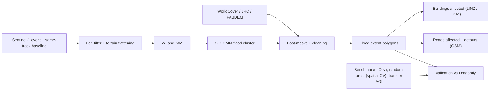

#  Geographically Informed Speculators (GIS)

GEOG761 group project (University of Auckland). We map **flood and inundation extent** from Sentinel-1 radar after a disaster, then count the buildings and roads affected. This is the first step in choosing a site for sea-based logistics during humanitarian assistance and disaster relief (HA/DR). The test case is **Cyclone Gabrielle** on the Napier–Hastings floodplain, February 2023.

Full method, design decisions and limitations: **[docs/methods.md](docs/methods.md)**.

---

## The problem

After a disaster, ports may fail and beach landings become the fallback. Roads are destroyed, communities are cut off, and pre-event survey data is no longer reliable. Responders need a fast, weather-independent map of where the water is and what it has cut off. Radar (SAR) is used because it sees through cloud during storms.

## How it works

1. **Sentinel-1 radar** for the event (single pass nearest the flood peak) and a one-year baseline on the **same orbit track** (per-pixel median).
2. **Preprocessing** of every scene: Lee speckle filter and terrain flattening (Vollrath et al., 2020), with layover and shadow masked.
3. Two features per pixel: water index `WI = VV + VH` (dB) and change `ΔWI = WI_baseline − WI_event`.
4. An **unsupervised Gaussian mixture model** groups the pixels. Flood is the group that is dark *and* newly darker than the baseline.
5. **Post-masks** remove permanent water (ESA WorldCover, JRC), the sea and steep or high ground (FABDEM).
6. **Exposure:** flood polygons are intersected with LINZ (or OSM) building outlines and the OSM road network, including in-AOI detours.

The GMM is benchmarked against a non-learning **Otsu threshold** and a supervised **random forest** (200 trees, 8 features, 4-fold spatial block cross-validation), and every method is rerun on a **second AOI** 35 km south-west to test transfer. A Sentinel-2 U-Net layer gives an optical cross-check, and an experimental silt model is discussed in [docs/methods.md](docs/methods.md#discussion).



The report version of this diagram is `outputs/pipeline_flowchart.png`, drawn by `scripts/make_flowchart.py`.

## Data sources

| Data | Source | Use |
| --- | --- | --- |
| Sentinel-1 GRD (VV, VH) | Copernicus via Google Earth Engine | Flood detection |
| Sentinel-2 L1C | Copernicus via Google Earth Engine | Optical cross-check (U-Net) |
| s2cloudless cloud probability | Google Earth Engine | Cloud mask for the optical cross-check |
| FABDEM bare-earth DEM | `projects/sat-io/open-datasets/FABDEM` | Elevation, slope, terrain flattening |
| ESA WorldCover 2021, JRC Global Surface Water | Google Earth Engine | Permanent water mask |
| NZ Building Outlines | [LINZ](https://data.linz.govt.nz/layer/101290-nz-building-outlines/) (local file) | Buildings affected |
| OpenStreetMap buildings and roads | Overpass / Geofabrik via `osmnx` | Roads affected, detours, building fallback |
| Dragonfly flood extent, 14 Feb 2023 | [Dragonfly Data Science](https://www.dragonfly.co.nz/news/2023-02-17-cyclone-gabrielle) | Validation reference |

## Key results (Cyclone Gabrielle, ±5 km at −39.58, 176.88)

| Metric | Value |
| --- | --- |
| Flood mapped vs reference | 12.52 km² vs 21.45 km² |
| Precision / Recall | 0.967 / 0.564 |
| F1 / IoU | 0.713 / 0.554 |
| Cohen's kappa / Overall accuracy | 0.653 / 0.894 |
| Recall, non-urban vs urban | 0.580 vs 0.001 |

### Method comparison (all with post-masks, F1 against Dragonfly)

| Method | Main AOI F1 | Second AOI F1 |
| --- | --- | --- |
| GMM (unsupervised, final) | 0.713 | 0.752 |
| k-means | 0.719 | 0.666 |
| Otsu threshold (no learning) | 0.854 | 0.757 |
| Random forest, spatial CV (trained locally) | 0.858 | 0.725 |
| Random forest trained on main AOI (transfer) | n/a | 0.743 |
| Sentinel-2 U-Net, whole AOI / clear sky | 0.594 / 0.664 | n/a |

In the main AOI, Otsu and the random forest beat the GMM, but in the second AOI the GMM, Otsu and the transferred random forest are within 0.015 F1. Urban recall stays near zero for every radar method, including the random forest. Full tables: `outputs/validation/method_comparison.csv` and `outputs/validation_aoi2/method_comparison.csv`.

The map is conservative: almost everything mapped as flood is flood, but about 44% of the reference flood is missed. Urban flooding is not detected because flooded streets stay bright in radar (double bounce). The reference is itself a Sentinel-1 product, so these scores measure method agreement and are an upper bound, not field accuracy. Scores are written to `outputs/validation/scores.csv`.


## Reproduce the results

**Prerequisites:** [uv](https://docs.astral.sh/uv/) (installs Python 3.13 for you) and a Google Earth Engine Cloud project.

```bash
git clone https://github.com/uoa-gis/GIS
cd GIS
uv sync                          # creates .venv with all dependencies (large: includes torch + tensorflow)
cp .env.example .env             # then edit .env (see below)
```

Set these in `.env`:

```
EE_PROJECT=your-earth-engine-project-id
GOOGLE_APPLICATION_CREDENTIALS=/path/to/service-account.json   # leave blank to use `uv run earthengine authenticate`
```

Check Earth Engine works (should print `2`):

```bash
uv run python -c "from processing.ee_auth import initialize_ee; import ee; initialize_ee(); print(ee.Number(1).add(1).getInfo())"
```

Open the repo folder in VS Code or Jupyter, select the `.venv` kernel, and run the notebooks in `notebooks/`:

| Notebook | Produces |
| --- | --- |
| `01_sentinel1_layer.ipynb` | Flood map, buildings and roads affected, `outputs/s1_road_detours.png` |
| `02_sentinel2_layer.ipynb` | Sentinel-2 U-Net flood layer |
| `04_validation.ipynb` | Scores, agreement map, model selection, Otsu baseline, random forest in `outputs/validation/` |
| `04b_validation_aoi2.ipynb` | Same comparison for the second AOI in `outputs/validation_aoi2/` |
| `05_silt_layer.ipynb` | Experimental silt model in `outputs/silt_layer/` (discussion only) |
| `06_study_area.ipynb` | Study area map with both AOIs, `outputs/study_area.png` |

The flowchart is redrawn with `uv run python scripts/make_flowchart.py`.

### Report figures

| Figure | File | Made by |
| --- | --- | --- |
| 1 Study area | `outputs/study_area.png` | `06_study_area.ipynb` |
| 2 Pipeline flowchart | `outputs/pipeline_flowchart.png` | `scripts/make_flowchart.py` |
| 3 GMM vs k-means feature space | `outputs/validation/gmm_feature_space.png` | `04_validation.ipynb` |
| 4 Flood map and exposure | `outputs/s1_flood_2x2.png` | `01_sentinel1_layer.ipynb` |
| 5 Agreement map | `outputs/validation/agreement.png` | `04_validation.ipynb` |
| 6 Model selection and precision–recall | `outputs/validation/model_selection.png` | `04_validation.ipynb` |
| 7 Random forest CV design and importance | `outputs/validation/rf_cv_importance.png` | `04_validation.ipynb` |
| 8 Sentinel-2 optical cross-check | `outputs/s2_unet_1x3.png` | `02_sentinel2_layer.ipynb` |

AOI, dates and thresholds are set in `notebooks/layer_config.py`. LINZ building outlines must be downloaded separately into `data/nz-building/` (see [docs/methods.md](docs/methods.md#counting-affected-buildings-linz-or-osm--flood)); without them, OSM buildings are used.

**Map app (optional):** choose any AOI and dates in the browser.

```bash
uv run uvicorn ui.app:app --reload --host 127.0.0.1 --port 8000
```

Then open http://127.0.0.1:8000. Runs take several minutes.

## Repository layout

```text
notebooks/      analysis notebooks (01–06, 04b) and layer_config.py
processing/     shared pipeline code (preprocessing, track choice, GMM, buildings, roads, S2)
outputs/        figures, flood polygons, validation/ (main AOI) and validation_aoi2/ scores
ui/             FastAPI + Leaflet map app
scripts/        download_osm.py (offline OSM data), make_flowchart.py (Figure 2)
data/           local LINZ building outlines (not committed)
docs/           methods.md: full technical detail
assets/         README images and logo
```

## Limitations

- Urban flooding is missed (radar double bounce).
- False alarms cluster on post-flood silt and wet ground.
- Tested on one event, in two flat AOIs.
- Sentinel-2 results are affected by cloud (43% of the main AOI) and over-predict flood (precision about 0.5).
- The validation reference is a model product from the same Sentinel-1 pass, not field survey data, so scores are an upper bound.

See [docs/methods.md](docs/methods.md#discussion) for detail and further work.

## Team contributions
 
| Member Name | Project contribution | Where it lives in the repo |
| ----------------- | -------------------- | -------------------------- |
| Benjamin McLean | Problem framing and scope (HA/DR site selection after a disaster), method and data selection, Cyclone Gabrielle case study | [The problem](#the-problem), [Methods](docs/methods.md#observation-and-method), [Expected product](docs/methods.md#expected-product-and-risks) |
| Dongwook Kim | Primary Sentinel-1 flood pipeline: unsupervised 2-D GMM on `WI` and `ΔWI`, WorldCover / JRC / FABDEM post-masks, flood vectorisation, area statistics; LINZ building and OSM road exposure | `notebooks/01_sentinel1_layer.ipynb`, `processing/pipeline.py`, `processing/buildings.py`, `processing/roads.py` |
| Jianing Shi | Methods research and assessment; map UI (Sentinel-1 and Sentinel-2 tabs); Sentinel-2 flood layer using a pretrained U-Net (inference only) | `ui/`, `notebooks/02_sentinel2_layer.ipynb`, `processing/s2_pipeline.py` |
| Jason Wong | Validation of the Sentinel-1 flood map against the Dragonfly 14 Feb flood extent (confusion matrix, precision, recall, F1, IoU, urban vs non-urban recall); GMM vs k-means, model selection, Otsu baseline, random forest with spatial CV, transfer to a second AOI | `notebooks/04_validation.ipynb`, `notebooks/04b_validation_aoi2.ipynb`, `outputs/validation/`, `outputs/validation_aoi2/` |
| Dhruv Patel | Experimental post-flood silt mapping (Random Forest, Dragonfly labels; not part of the validated product or UI); limitations analysis and further work | `notebooks/05_silt_layer.ipynb`, `outputs/silt_layer/`, [Discussion](docs/methods.md#discussion) |
